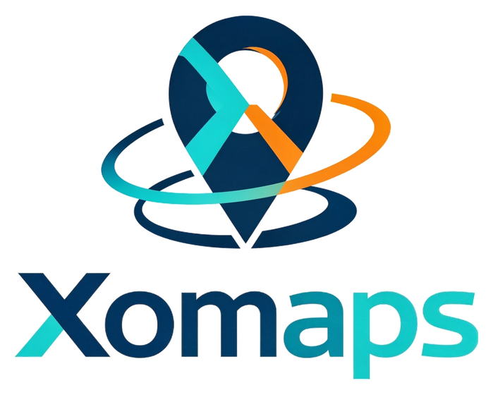
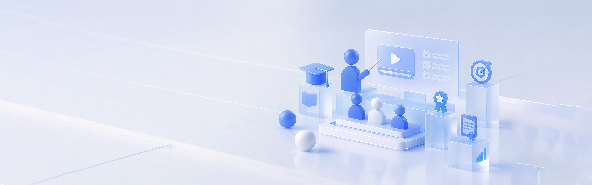
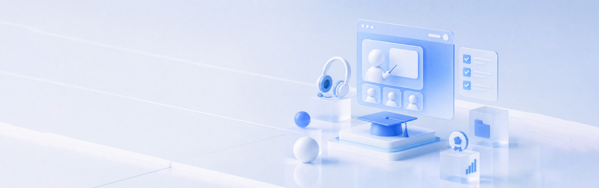
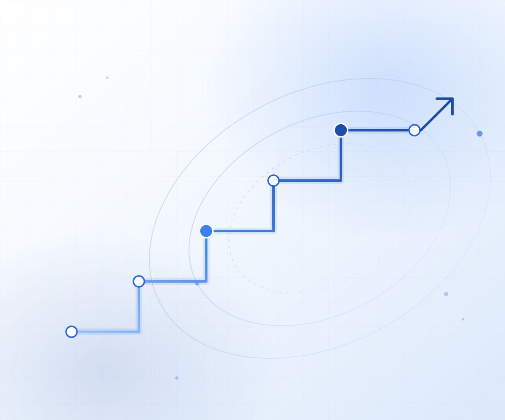

---
title: "信朴科技 | 自研软件产品与企业 AI 落地服务商"
description: "广州信朴科技有限公司以自研底座为支撑，自研软件产品产权自有、按需求交付，支持 SaaS 订阅、私有化部署与一站式全包交付（域名、服务器、SSL 证书与域名解析一并配齐），并上架云市场与企业微信应用市场。同时提供企业 AI 落地、Agent 定制与 AI 原生研发服务。"
keywords: "自研软件,软件授权,私有化部署,SaaS订阅,一站式交付,企业微信应用,云市场,Agent定制,企业AI落地,信朴科技"
nav: "home"
date: 2026-11-18
draft: false
------

企业 AI 能力建设与应用落地服务商

信朴科技 XOMAPS

0 %

<section class="hero" style="padding-top:0;">

企业 AI 能力建设与应用落地服务商 · 自研软件产品产权自有

<h1>让 AI 真正走进企业的业务流程</h1>

信朴科技以自研软件产品为底座，围绕企业 AI 落地提供咨询、培训、工具模型、Agent 定制与内化建设的一体化支持——学·用·建·管，一站式闭环。

自研软件产品产权自有SaaS 订阅与私有化部署企业微信应用上架云市场入驻服务商

<a href="/contact.html#form" class="btn btn-accent btn-lg">联系信朴科技</a><a href="/services.html" class="btn btn-ghost btn-lg">查看服务</a>

学 · 用 · 建 · 管 —— 企业 AI 落地闭环方法论

<h1>不只是培训，更是让人把 AI 用起来</h1>

从高管认知到员工实操，从 Prompt 工程到 Agent 定制，信朴科技陪企业完成 AI 落地的每一步。

企业 AI 培训WorkBuddy 推广Agent 定制场景化落地

<a href="/ai-training.html" class="btn btn-accent btn-lg">了解培训</a><a href="/ai-landing.html" class="btn btn-ghost btn-lg">落地路径</a>

自研 SaaS · 私有化部署 · 双形态交付

<h1>云 + AI 一体化，让企业少走弯路</h1>

依托自研软件底座与私有化交付能力，结合 AI 落地咨询与实施，帮助企业建设安全、可扩展、产权自主的数字化底座。

私有化部署全包交付云市场上架企微应用上架

<a href="/cloud.html" class="btn btn-accent btn-lg">私有化部署</a><a href="tel:18926108189" class="btn btn-ghost btn-lg">咨询报价</a>

<svg viewBox="0 0 24 24" fill="none" stroke="#2563eb" stroke-width="2" stroke-linecap="round" stroke-linejoin="round"><path d="M22 11.08V12a10 10 0 1 1-5.93-9.14"/><path d="M22 4L12 14.01l-3-3"/></svg>

自研

软件产品产权自有

<svg viewBox="0 0 24 24" fill="none" stroke="#f97316" stroke-width="2" stroke-linecap="round" stroke-linejoin="round"><circle cx="12" cy="12" r="10"/><path d="M2 12h20M12 2a15.3 15.3 0 0 1 4 10 15.3 15.3 0 0 1-4 10 15.3 15.3 0 0 1-4-10 15.3 15.3 0 0 1 4-10z"/></svg>

双形态

SaaS 订阅与私有化部署

<svg viewBox="0 0 24 24" fill="none" stroke="#2563eb" stroke-width="2" stroke-linecap="round" stroke-linejoin="round"><path d="M17 21v-2a4 4 0 0 0-4-4H5a4 4 0 0 0-4 4v2"/><circle cx="9" cy="7" r="4"/><path d="M23 21v-2a4 4 0 0 0-3-3.87M16 3.13a4 4 0 0 1 0 7.75"/></svg>

全包

域名、服务器、证书与解析一站式

<button class="hero-arrow prev" aria-label="上一个"><svg viewBox="0 0 24 24" fill="none" stroke="currentColor" stroke-width="2" stroke-linecap="round" stroke-linejoin="round"><polyline points="15 18 9 12 15 6"/></svg></button>
<button class="hero-arrow next" aria-label="下一个"><svg viewBox="0 0 24 24" fill="none" stroke="currentColor" stroke-width="2" stroke-linecap="round" stroke-linejoin="round"><polyline points="9 18 15 12 9 6"/></svg></button>

<button class="active" data-i="0"></button><button data-i="1"></button><button data-i="2"></button>

</section>

<section class="trust-bar" style="padding:20px 0;">

<svg viewBox="0 0 24 24" fill="none" stroke="currentColor" stroke-width="2" stroke-linecap="round" stroke-linejoin="round"><path d="M12 22s8-4 8-10V5l-8-3-8 3v7c0 6 8 10 8 10z"/><path d="M9 12l2 2 4-4"/></svg>自研软件产权自有

<svg viewBox="0 0 24 24" fill="none" stroke="currentColor" stroke-width="2" stroke-linecap="round" stroke-linejoin="round"><path d="M2 3h6a4 4 0 0 1 4 4v14a3 3 0 0 0-3-3H2z"/><path d="M22 3h-6a4 4 0 0 0-4 4v14a3 3 0 0 1 3-3h7z"/></svg>SaaS 与私有化双交付

<svg viewBox="0 0 24 24" fill="none" stroke="currentColor" stroke-width="2" stroke-linecap="round" stroke-linejoin="round"><path d="M22 11.08V12a10 10 0 1 1-5.93-9.14"/><path d="M22 4L12 14.01l-3-3"/></svg>企业微信应用上架

<svg viewBox="0 0 24 24" fill="none" stroke="currentColor" stroke-width="2" stroke-linecap="round" stroke-linejoin="round"><path d="M16 18l6-6-6-6M8 6l-6 6 6 6"/></svg>一站式全包交付

</section>

<section id="services">

SERVICE DIRECTIONS

<h2 class="sec-title">七大服务方向，覆盖 AI 落地全链路</h2>

企业所处阶段不同，需要的服务也不同。信朴科技的服务可以独立采购，也可以组合为完整的企业 AI 建设项目。

<a href="/ai-efficiency.html">
01

<svg viewBox="0 0 24 24" fill="none" stroke="currentColor" stroke-width="2" stroke-linecap="round" stroke-linejoin="round"><path d="M13 2L3 14h9l-1 8 10-12h-9l1-8z"/></svg>
<h4>AI 提效</h4>
学·用·建·管，一站式闭环
<ul class="svc-features"><li>企业 AI 培训 + 模型用量 + Agent 定制 + 咨询</li><li>让人会用 AI、让模型用得省</li><li>让场景真落地、让投入沉淀为资产</li></ul><a href="/ai-efficiency.html" class="svc-link">了解详情<svg viewBox="0 0 24 24" fill="none" stroke="currentColor" stroke-width="2" stroke-linecap="round" stroke-linejoin="round"><line x1="5" y1="12" x2="19" y2="12"/><polyline points="12 5 19 12 12 19"/></svg></a>
</a>

<a href="/cloud.html">
02

<svg viewBox="0 0 24 24" fill="none" stroke="currentColor" stroke-width="2" stroke-linecap="round" stroke-linejoin="round"><path d="M18 10h-1.26A8 8 0 1 0 9 20h9a5 5 0 0 0 0-10z"/></svg>
<h4>私有化部署与托管</h4>
软件产权自有 · 按需求交付
<ul class="svc-features"><li>私有化环境交付与运维托管</li><li>域名、服务器、证书、解析全包配齐</li><li>SaaS 订阅与私有化双形态可选</li></ul><a href="/cloud.html" class="svc-link">了解详情<svg viewBox="0 0 24 24" fill="none" stroke="currentColor" stroke-width="2" stroke-linecap="round" stroke-linejoin="round"><line x1="5" y1="12" x2="19" y2="12"/><polyline points="12 5 19 12 12 19"/></svg></a>
</a>

<a href="/ai-landing.html">
03

<svg viewBox="0 0 24 24" fill="none" stroke="currentColor" stroke-width="2" stroke-linecap="round" stroke-linejoin="round"><path d="M12 2L2 7l10 5 10-5-10-5z"/><path d="M2 17l10 5 10-5M2 12l10 5 10-5"/></svg>
<h4>AI 落地</h4>
从场景到业务，真实落地
<ul class="svc-features"><li>场景识别与 AI 机会诊断</li><li>工具导入与工作流改造</li><li>FDE 现场共创，真实材料验证</li></ul><a href="/ai-landing.html" class="svc-link">了解详情<svg viewBox="0 0 24 24" fill="none" stroke="currentColor" stroke-width="2" stroke-linecap="round" stroke-linejoin="round"><line x1="5" y1="12" x2="19" y2="12"/><polyline points="12 5 19 12 12 19"/></svg></a>
</a>

<a href="/ai-training.html">
04

<svg viewBox="0 0 24 24" fill="none" stroke="currentColor" stroke-width="2" stroke-linecap="round" stroke-linejoin="round"><path d="M22 10v6M2 10l10-5 10 5-10 5z"/><path d="M6 12v5c3 3 9 3 12 0v-5"/></svg>
<h4>AI 转型培训</h4>
建立认知 · 普及能力 · 培养骨干
<ul class="svc-features"><li>线上：WorkBuddy 使用 / Prompt 工程</li><li>线下七大模块：通识 / 思维 / Vibe Coding</li><li>诊断式定制训练营 · 标准课程包</li></ul><a href="/ai-training.html" class="svc-link">了解详情<svg viewBox="0 0 24 24" fill="none" stroke="currentColor" stroke-width="2" stroke-linecap="round" stroke-linejoin="round"><line x1="5" y1="12" x2="19" y2="12"/><polyline points="12 5 19 12 12 19"/></svg></a>
</a>

<a href="/agent.html">
05

<svg viewBox="0 0 24 24" fill="none" stroke="currentColor" stroke-width="2" stroke-linecap="round" stroke-linejoin="round"><rect x="3" y="11" width="18" height="10" rx="2"/><circle cx="12" cy="5" r="2"/><path d="M12 7v4M8 16h.01M16 16h.01"/></svg>
<h4>Agent 定制</h4>
FDE 现场共创 · 五步法落地
<ul class="svc-features"><li>知识问答 / 客服 / 销售辅助</li><li>运营分析 / 报告 / 流程协同</li><li>场景→知识→原型→试点→交接</li></ul><a href="/agent.html" class="svc-link">了解详情<svg viewBox="0 0 24 24" fill="none" stroke="currentColor" stroke-width="2" stroke-linecap="round" stroke-linejoin="round"><line x1="5" y1="12" x2="19" y2="12"/><polyline points="12 5 19 12 12 19"/></svg></a>
</a>

<a href="/token-supply.html">
06

<svg viewBox="0 0 24 24" fill="none" stroke="currentColor" stroke-width="2" stroke-linecap="round" stroke-linejoin="round"><circle cx="12" cy="12" r="10"/><path d="M12 6v6l4 2"/></svg>
<h4>Token 供应</h4>
GPT · Gemini 等主流模型
<ul class="svc-features"><li>模型用量稳定供给与资源管理</li><li>50 席以上赠 2000 元兑换券</li><li>后续用量约官网 45 折</li></ul><a href="/token-supply.html" class="svc-link">了解详情<svg viewBox="0 0 24 24" fill="none" stroke="currentColor" stroke-width="2" stroke-linecap="round" stroke-linejoin="round"><line x1="5" y1="12" x2="19" y2="12"/><polyline points="12 5 19 12 12 19"/></svg></a>
</a>

<a href="/workbuddy-training.html">
07

<svg viewBox="0 0 24 24" fill="none" stroke="currentColor" stroke-width="2" stroke-linecap="round" stroke-linejoin="round"><path d="M14 2H6a2 2 0 0 0-2 2v16a2 2 0 0 0 2 2h12a2 2 0 0 0 2-2V8z"/><polyline points="14 2 14 8 20 8"/><line x1="16" y1="13" x2="8" y2="13"/><line x1="16" y1="17" x2="8" y2="17"/><polyline points="10 9 9 9 8 9"/></svg>
<h4>WorkBuddy 培训</h4>
AI 办公助手专项培训
<ul class="svc-features"><li>WorkBuddy 使用方法与最佳实践</li><li>Prompt 工程与知识库搭建</li><li>50 席起购，面向企业全员推广</li></ul><a href="/workbuddy-training.html" class="svc-link">了解详情<svg viewBox="0 0 24 24" fill="none" stroke="currentColor" stroke-width="2" stroke-linecap="round" stroke-linejoin="round"><line x1="5" y1="12" x2="19" y2="12"/><polyline points="12 5 19 12 12 19"/></svg></a>
</a>

<button class="svc-prev" aria-label="上一个"><svg viewBox="0 0 24 24" fill="none" stroke="currentColor" stroke-width="2" stroke-linecap="round" stroke-linejoin="round"><polyline points="15 18 9 12 15 6"/></svg></button>

<button class="svc-next" aria-label="下一个"><svg viewBox="0 0 24 24" fill="none" stroke="currentColor" stroke-width="2" stroke-linecap="round" stroke-linejoin="round"><polyline points="9 18 15 12 9 6"/></svg></button>

</section>

<section class="bg-soft" id="about">

ABOUT XOMAPS · 关于信朴科技

<h2 class="sec-title">让 AI 真正走进企业的业务流程</h2>

企业 AI 能力建设与应用落地服务商 · 自研软件产品产权自有

自研底座

自研

软件产品产权自有

双形态

SaaS 与私有化

全包

一站式交付

<!-- 视频播放器代码预留：企业介绍视频制作完成后取消注释即可启用
<video id="aboutVideoEl" controls playsinline preload="none" style="display:none;z-index:2;"></video>

<svg viewBox="0 0 24 24" fill="currentColor"><path d="M5 3l14 9-14 9V3z"/></svg>

-->

广州信朴科技有限公司，<strong>企业 AI 能力建设与应用落地服务商</strong>。自研底座与企业级智能体平台双轨交付，围绕企业 AI 落地提供咨询、培训、工具模型、Agent 定制与内化建设的一体化支持——<strong>学 · 用 · 建 · 管</strong>，一站式闭环。软件产品产权自有，支持 SaaS 订阅与私有化部署，并可上架云市场与企业微信应用市场交付。

<svg viewBox="0 0 24 24" fill="none" stroke="currentColor" stroke-width="2" stroke-linecap="round" stroke-linejoin="round"><path d="M12 22s8-4 8-10V5l-8-3-8 3v7c0 6 8 10 8 10z"/><path d="M9 12l2 2 4-4"/></svg>

底座双轨

自研底座与企业级智能体平台，按需选型

<svg viewBox="0 0 24 24" fill="none" stroke="currentColor" stroke-width="2" stroke-linecap="round" stroke-linejoin="round"><path d="M22 11.08V12a10 10 0 1 1-5.93-9.14"/><path d="M22 4L12 14.01l-3-3"/></svg>

双形态交付

SaaS 订阅与私有化部署

<svg viewBox="0 0 24 24" fill="none" stroke="currentColor" stroke-width="2" stroke-linecap="round" stroke-linejoin="round"><circle cx="12" cy="12" r="10"/><path d="M2 12h20M12 2a15.3 15.3 0 0 1 4 10 15.3 15.3 0 0 1-4 10 15.3 15.3 0 0 1-4-10 15.3 15.3 0 0 1 4-10z"/></svg>

开放生态

云市场与企业微信应用上架

让企业里的每一个人，都能把 AI 真正用起来。AI 的价值不在演示，而在业务闭环——信朴科技的使命是帮助企业完成从认知、工具到组织能力的内化。

— 信朴科技 · 企业理念

<a href="/workbuddy-training.html" class="as-card">
<svg viewBox="0 0 24 24" fill="none" stroke="currentColor" stroke-width="2" stroke-linecap="round" stroke-linejoin="round"><path d="M22 10v6M2 10l10-5 10 5-10 5z"/><path d="M6 12v5c3 3 9 3 12 0v-5"/></svg>

企业 AI 培训
</a>
<a href="/token-supply.html" class="as-card">
<svg viewBox="0 0 24 24" fill="none" stroke="currentColor" stroke-width="2" stroke-linecap="round" stroke-linejoin="round"><circle cx="12" cy="12" r="10"/><path d="M12 6v6l4 2"/></svg>

模型 Token 供应
</a>
<a href="/agent.html" class="as-card">
<svg viewBox="0 0 24 24" fill="none" stroke="currentColor" stroke-width="2" stroke-linecap="round" stroke-linejoin="round"><rect x="3" y="11" width="18" height="10" rx="2"/><circle cx="12" cy="5" r="2"/><path d="M12 7v4"/></svg>

Agent 定制与 FDE
</a>
<a href="/cloud.html" class="as-card">
<svg viewBox="0 0 24 24" fill="none" stroke="currentColor" stroke-width="2" stroke-linecap="round" stroke-linejoin="round"><path d="M18 10h-1.26A8 8 0 1 0 9 20h9a5 5 0 0 0 0-10z"/></svg>

私有化部署与咨询
</a>

</section>

<section class="bg-gradient">

WHY XOMAPS
<h2 class="sec-title">既是落地服务商，也是 AI 落地亲历者</h2>
信朴科技不止于做演示——从咨询到应用的一体化能力，让 AI 真正落进业务流程。

<svg viewBox="0 0 24 24" fill="none" stroke="currentColor" stroke-width="2" stroke-linecap="round" stroke-linejoin="round"><path d="M21 16V8a2 2 0 0 0-1-1.73l-7-4a2 2 0 0 0-2 0l-7 4A2 2 0 0 0 3 8v8a2 2 0 0 0 1 1.73l7 4a2 2 0 0 0 2 0l7-4A2 2 0 0 0 21 16z"/></svg>
<h4>一体化能力</h4>
同时具备咨询、培训、工具、模型、知识库和 Agent 服务能力，减少多个供应商之间的沟通与割裂。

<svg viewBox="0 0 24 24" fill="none" stroke="currentColor" stroke-width="2" stroke-linecap="round" stroke-linejoin="round"><circle cx="12" cy="12" r="10"/><circle cx="12" cy="12" r="6"/><circle cx="12" cy="12" r="2"/></svg>
<h4>业务起点</h4>
更关注员工每天在做什么、哪些环节最耗时间，而不是先从某个模型或工具出发设计项目。

<svg viewBox="0 0 24 24" fill="none" stroke="currentColor" stroke-width="2" stroke-linecap="round" stroke-linejoin="round"><path d="M22 11.08V12a10 10 0 1 1-5.93-9.14"/><path d="M22 4L12 14.01l-3-3"/></svg>
<h4>实操共建</h4>
无论培训还是定制项目，都使用客户真实材料、真实流程和真实任务验证结果，避免交付后无法使用。

<svg viewBox="0 0 24 24" fill="none" stroke="currentColor" stroke-width="2" stroke-linecap="round" stroke-linejoin="round"><path d="M12 2v4M12 18v4M4.93 4.93l2.83 2.83M16.24 16.24l2.83 2.83M2 12h4M18 12h4M4.93 19.07l2.83-2.83M16.24 7.76l2.83-2.83"/></svg>
<h4>短期与长期兼顾</h4>
先用培训和试点获得可见成果，再逐步建设知识库、Agent 与内部人才体系，控制投入节奏和实施风险。

</section>

<section>

METHODOLOGY
<h2 class="sec-title">学·用·建·管，让 AI 真正闭环</h2>
信朴科技的四个坚持，不是口号，而是企业 AI 落地中真正遵循的工作方式——从方向到人，从工具到价值。

<svg viewBox="0 0 24 24" fill="none" stroke="currentColor" stroke-width="2" stroke-linecap="round" stroke-linejoin="round"><path d="M22 10v6M2 10l10-5 10 5-10 5z"/><path d="M6 12v5c3 3 9 3 12 0v-5"/></svg>

STEP 01 · 学
<h4>以咨询定方向</h4>
先识别 AI 机会、梳理场景、设计路径，让企业在投入之前看清方向，避免盲目采购和零散试用。

<svg viewBox="0 0 24 24" fill="none" stroke="currentColor" stroke-width="2" stroke-linecap="round" stroke-linejoin="round"><path d="M14 7h7v7M21 7l-9 9-3-3-5 5"/></svg>

STEP 02 · 用
<h4>以实操培育人</h4>
通过真实任务训练，让员工不仅「听懂 AI」，更能在岗位中用起来，把方法变成可复用的能力。

<svg viewBox="0 0 24 24" fill="none" stroke="currentColor" stroke-width="2" stroke-linecap="round" stroke-linejoin="round"><path d="M21 16V8a2 2 0 0 0-1-1.73l-7-4a2 2 0 0 0-2 0l-7 4A2 2 0 0 0 3 8v8a2 2 0 0 0 1 1.73l7 4a2 2 0 0 0 2 0l7-4A2 2 0 0 0 21 16z"/></svg>

STEP 03 · 建
<h4>以工具承载场景</h4>
为员工提供稳定、统一、便于推广的 AI 使用入口——让工具进入真实工作流，而不是停留在演示里。

<svg viewBox="0 0 24 24" fill="none" stroke="currentColor" stroke-width="2" stroke-linecap="round" stroke-linejoin="round"><path d="M12 2L2 7l10 5 10-5-10-5z"/><path d="M2 17l10 5 10-5M2 12l10 5 10-5"/></svg>

STEP 04 · 管
<h4>以应用实现价值</h4>
把验证有效的做法固化为知识库、流程、Agent 与组织机制——让 AI 变成可持续的业务能力。

</section>

<section class="bg-soft">

CAPABILITIES
<h2 class="sec-title">自研底座支撑，按需求交付</h2>
从产品形态到交付方式，每一项能力都围绕企业 AI 真实落地构建。

自研

软件产品产权自有

双形态

SaaS 订阅与私有化部署

全包

域名、服务器、证书与解析一站式

企微

企业微信应用上架

云市场

云市场服务商入驻

开放

开放接口与生态接入

闭环

学 · 用 · 建 · 管方法论

长期

版本持续迭代与本地支持

</section>

<section class="clients-section">

TRUSTED BY · 合作客户

<h2 class="sec-title">多行业企业的共同选择</h2>

从新能源汽车到金融科技，信朴科技的合作实践覆盖制造、服务与科技专业服务行业。

车

某新能源汽车企业

新能源汽车

行

某智慧出行平台

智慧出行

装

某装备制造企业

装备制造

芯

某半导体企业

半导体

邮

某邮政物流企业

邮政物流

游

某游戏研发企业

游戏文娱

教

某教育科技企业

教育科技

电

某工业电子企业

工业电子

岩

某运动连锁品牌

运动休闲

服

某企业服务平台

企业服务 SaaS

人

某人力资源机构

人力资源

建

某建材陶瓷企业

建材陶瓷

产

某知识产权机构

知识产权

金

某金融科技企业

金融科技

车

某新能源汽车企业

新能源汽车

行

某智慧出行平台

智慧出行

装

某装备制造企业

装备制造

芯

某半导体企业

半导体

邮

某邮政物流企业

邮政物流

游

某游戏研发企业

游戏文娱

教

某教育科技企业

教育科技

电

某工业电子企业

工业电子

岩

某运动连锁品牌

运动休闲

服

某企业服务平台

企业服务 SaaS

人

某人力资源机构

人力资源

建

某建材陶瓷企业

建材陶瓷

产

某知识产权机构

知识产权

金

某金融科技企业

金融科技

</section>

<section class="bg-soft">

INDUSTRY COVERAGE
<h2 class="sec-title">跨行业实践，自研底座持续沉淀</h2>
信朴科技的合作实践覆盖企业 AI 咨询、能力培养、工具导入和业务场景应用建设，客户来自制造业、服务业与科技专业服务三大板块。

新能源汽车智慧出行装备制造半导体芯片
邮政物流建材陶瓷知识产权金融科技
游戏文娱企业服务人力资源教育科技
工业电子运动休闲科技服务

</section>

<!-- ══════════ WebGL 流体特效（Three.js） ══════════ -->

