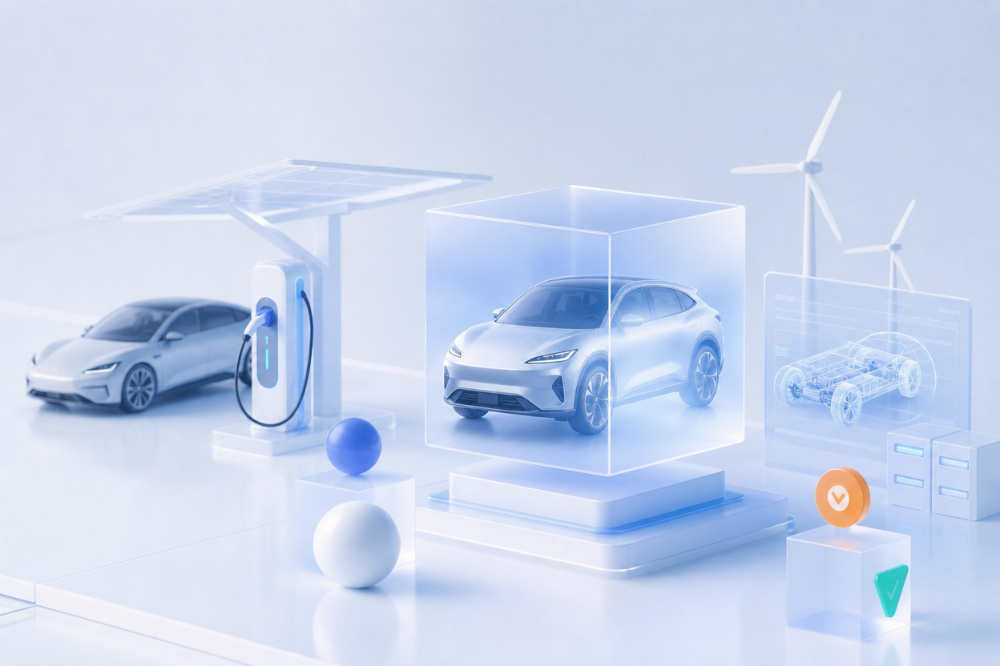
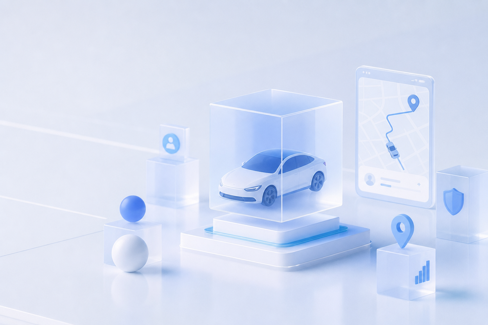
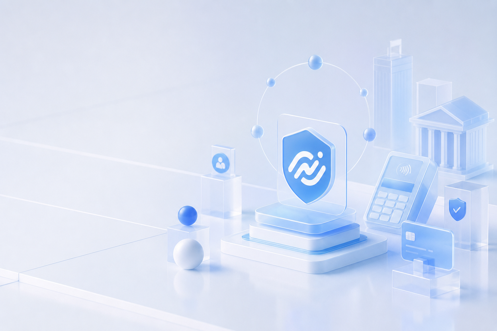
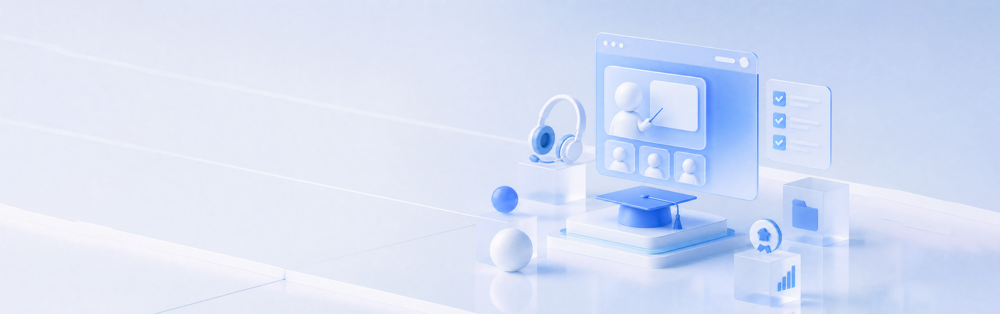

---
title: "行业场景与交付实践 - 信朴科技"
description: "信朴科技交付实践：覆盖户外媒体、装备制造、企业服务、知识产权与科技服务等业务场景，展示自研业务系统、Agent 定制与私有化部署在真实流程中的落地方式。"
keywords: "行业场景,交付实践,自研业务系统,私有化部署,信朴科技"
nav: "cases"
date: 2026-11-18
draft: false
------

<!-- WebGL 流体背景 -->

<!-- Hero -->
<header class="hero" id="top">

多行业落地实践 · 真实场景验证

<h1 class="reveal reveal-d1">每一次落地， 都是 AI 变生产力 的真实证明</h1>

从新能源汽车到金融科技，从半导体到建材制造——信朴科技的服务已在多行业的头部企业中跑通闭环。不讲概念，只看结果。

双形态

SaaS 订阅与私有化部署

全包

域名、服务器、证书与解析

7大产品

独立或组合交付

<a href="#cases" class="btn btn-primary">浏览全部案例 <svg viewBox="0 0 24 24" fill="none" stroke="currentColor" stroke-width="2.5"><path d="M12 5v14M5 12l7 7 7-7"/></svg></a>
<a href="#contact" class="btn btn-ghost">预约场景诊断</a>

</header>

<!-- 精选案例 -->
<section class="featured" id="featured">

FEATURED CASE · 精选案例

<h2 class="sec-title">标杆实践：国内知名汽车企业 × AI 提效</h2>

新能源汽车领军企业如何通过信朴科技的「学·用·建·管」闭环，实现团队 AI 能力的系统性跃升。

<!-- 精选案例跳转链接：替换 href 即可指向详情页/外部URL -->
<a href="/case-gac-aion.html" class="featured-link">

<!-- 精选案例背景图：每个案例可单独换 src（建议 16:9 或 4:3，留出右侧文案空间） -->

精选案例

国内知名汽车企业

新能源汽车 · 智能制造

AI 提效 · 综合服务

<h3>从「不会用 AI」到「全员 AI 提效」的组织升级</h3>

国内知名汽车企业作为新能源汽车头部企业，研发与业务团队规模庞大，但 AI 工具的使用率低、场景分散、成本不可控。信朴科技以「学·用·建·管」一站式闭环切入，从培训赋能到 Agent 定制，系统性提升全员 AI 生产力。

WorkBuddy 培训
Token 供应
Agent 定制
AI 咨询

全员

AI 日常化使用推进

45折

模型用量约官网成本

5类 Agent

场景化应用上线

</a>

</section>

<!-- 案例网格 -->
<section class="cases-section" id="cases">

CASE STUDIES · 客户案例

<h2 class="sec-title">更多行业落地实践</h2>

<button class="active" data-filter="all">全部</button>
<button data-filter="auto">汽车出行</button>
<button data-filter="finance">金融科技</button>
<button data-filter="manufacture">制造工业</button>
<button data-filter="tech">科技服务</button>

<!-- 1. 国内知名出行企业 -->
<article class="case-card c-auto reveal" data-cat="auto">

<a href="/case-ruqi-mobility.html" class="case-link">

<!-- 案例配图：每个栏目可单独换 src（建议 16:9） -->

出行平台

国内知名出行企业

Robotaxi · 智慧出行

出行平台客服与运营数据量大，人工处理效率受限，需要 AI 辅助提升响应速度与数据分析能力。

私有化部署
Agent 定制
Token 供应

7×24

高峰客服覆盖

24/7

运营分析覆盖

</a>
</article>

<!-- 2. 国内知名支付科技企业 -->
<article class="case-card c-finance reveal reveal-d1" data-cat="finance">

<a href="/case-yinsheng-pay.html" class="case-link">

金融科技

国内知名支付科技企业

支付 · 金融数据

支付场景涉及大量交易数据处理与风险监控，需要 AI Agent 辅助运营分析与异常检测。

Agent 定制
AI 落地
Token 供应

3类

运营 Agent 上线

45折

模型用量成本

</a>
</article>

<!-- 3. 国内知名电梯制造企业 -->
<article class="case-card c-manufacture reveal reveal-d2" data-cat="manufacture">

<a href="/case-guangri-elevator.html" class="case-link">

装备制造

国内知名电梯制造企业

智能装备 · 工业制造

制造企业研发与文档管理流程重，员工 AI 使用基础薄弱，需要系统性培训与场景化落地。

WorkBuddy 培训
AI 提效
知识库建设

200+ 人

完成 AI 培训

8个

业务场景落地

</a>
</article>

<!-- 4. 国内知名芯片企业 -->
<article class="case-card c-semi reveal" data-cat="tech">

<a href="/case-guomin-tech.html" class="case-link">

半导体

国内知名芯片企业

芯片设计 · 信息安全

芯片设计企业研发协作复杂，需要 AI 辅助代码生成与审查、技术文档知识问答等场景。

AI 转型
Agent 定制
Token 供应

2个

研发 Agent 部署

40%

研发效率提升

</a>
</article>

<!-- 5. 国内知名陶瓷建材企业 -->
<article class="case-card c-ceramic reveal reveal-d1" data-cat="manufacture">

<a href="/case-dongpeng-ceramics.html" class="case-link">

建材陶瓷

国内知名陶瓷建材企业

建材 · 品牌制造

传统建材企业数字化转型需求迫切，需要从零开始构建团队 AI 意识与基础应用能力。

WorkBuddy 培训
AI 提效
AI 咨询

150+ 人

员工 AI 启蒙

5大模块

线下训练营交付

</a>
</article>

<!-- 6. 国内知名科创服务企业 -->
<article class="case-card c-saas reveal reveal-d2" data-cat="tech">

<a href="/case-qizhidao.html" class="case-link">

企业服务 SaaS

国内知名科创服务企业

企业服务 · SaaS 平台

SaaS 平台需要将 AI 能力嵌入产品体验，从知识问答到智能推荐，需要 Agent 定制与 Token 供应支持。

AI 落地
Agent 定制
Token 供应

4类

智能 Agent 上线

FDE

现场共创交付

</a>
</article>

<!-- 7. 云南省央企背景综合运营国企 -->
<article class="case-card c-logistics reveal" data-cat="service">

<a href="/case-china-post-yunnan.html" class="case-link">

邮政服务

云南省央企背景综合运营国企

邮政 · 综合服务

大型央企分支机构员工基数大，AI 应用从管理层到一线需要分层赋能与场景化培训。

WorkBuddy 培训
AI 提效
定制训练营

500+ 席

培训平台部署

3层

分层赋能体系

</a>
</article>

<!-- 8. 国内知名知识产权服务企业 -->
<article class="case-card c-service reveal reveal-d1" data-cat="tech">

<a href="/case-huajin-ip.html" class="case-link">

知识产权

国内知名知识产权服务企业

知识产权 · 专业服务

知识产权服务涉及大量文档处理与专业问答，需要 AI 辅助专利分析、文档生成与知识检索。

Agent 定制
知识库建设
Token 供应

1个

知识问答 Agent

FDE

现场共创交付

</a>
</article>

</section>

<!-- 成果数据条 -->
<section class="impact-section" id="impact">

IMPACT · 成果数据

<h2 class="sec-title">数字背后，是真实的生产力</h2>

自研底座与一站式交付能力，支撑每一次真实落地。

双形态

交付形态 SaaS 与私有化

全包

交付范围 域名、服务器、证书与解析

45折

模型用量 约官网成本

长期

持续迭代 版本更新与本地支持

</section>

<!-- 客户Logo墙 -->
<section class="clients-section" id="clients">

TRUSTED BY · 合作客户

<h2 class="sec-title">多行业企业的共同选择</h2>

从新能源汽车到金融科技，信朴科技的合作实践覆盖制造、服务与科技专业服务行业。

车

某新能源汽车企业

新能源汽车

行

某智慧出行平台

出行平台

装

某装备制造企业

装备制造

芯

某半导体企业

半导体

邮

某邮政物流企业

邮政服务

游

某游戏研发企业

游戏

教

某教育科技企业

教育科技

电

某工业电子企业

工业电子

岩

该运动连锁品牌

运动休闲

服

某企业服务平台

企业服务 SaaS

人

某人力资源机构

人力资源

建

某建材陶瓷企业

建材陶瓷

产

某知识产权机构

知识产权

金

某金融科技企业

金融科技

车

某新能源汽车企业

新能源汽车

行

某智慧出行平台

出行平台

装

某装备制造企业

装备制造

芯

某半导体企业

半导体

邮

某邮政物流企业

邮政服务

游

某游戏研发企业

游戏

教

某教育科技企业

教育科技

电

某工业电子企业

工业电子

岩

该运动连锁品牌

运动休闲

服

某企业服务平台

企业服务 SaaS

人

某人力资源机构

人力资源

建

某建材陶瓷企业

建材陶瓷

产

某知识产权机构

知识产权

金

某金融科技企业

金融科技

</section>

<!-- CTA -->
<section class="cta-section" id="contact">

<h2>下一个案例， 或许就是您的企业</h2>

每一个行业、每一个场景都有独特的 AI 落地路径。预约一次免费诊断，让我们帮您找到最短路径。

<a href="tel:18926108189" class="btn btn-accent">立即拨打商务电话 <svg viewBox="0 0 24 24" fill="none" stroke="currentColor" stroke-width="2.5"><path d="M22 16.92v3a2 2 0 0 1-2.18 2 19.79 19.79 0 0 1-8.63-3.07 19.5 19.5 0 0 1-6-6 19.79 19.79 0 0 1-3.07-8.67A2 2 0 0 1 4.11 2h3a2 2 0 0 1 2 1.72c.127.96.36 1.903.7 2.81a2 2 0 0 1-.45 2.11L8.09 9.91a16 16 0 0 0 6 6l1.27-1.27a2 2 0 0 1 2.11-.45c.907.34 1.85.573 2.81.7A2 2 0 0 1 22 16.92z"/></svg></a>

<svg viewBox="0 0 24 24" fill="none" stroke="currentColor" stroke-width="2"><path d="M22 16.92v3a2 2 0 0 1-2.18 2 19.79 19.79 0 0 1-8.63-3.07 19.5 19.5 0 0 1-6-6 19.79 19.79 0 0 1-3.07-8.67A2 2 0 0 1 4.11 2h3a2 2 0 0 1 2 1.72c.127.96.36 1.903.7 2.81a2 2 0 0 1-.45 2.11L8.09 9.91a16 16 0 0 0 6 6l1.27-1.27a2 2 0 0 1 2.11-.45c.907.34 1.85.573 2.81.7A2 2 0 0 1 22 16.92z"/></svg>

商务咨询
冯小姐 · 18926108189

<svg viewBox="0 0 24 24" fill="none" stroke="currentColor" stroke-width="2"><path d="M21 10c0 7-9 13-9 13s-9-6-9-13a9 9 0 0 1 18 0z"/><circle cx="12" cy="10" r="3"/></svg>

总部地址
广州市天河区金穗路1号邦华广场5楼

<svg viewBox="0 0 24 24" fill="none" stroke="currentColor" stroke-width="2"><path d="M3 7l9 6 9-6M3 7v10a2 2 0 0 0 2 2h14a2 2 0 0 0 2-2V7M3 7l2-2h14l2 2"/></svg>

企业邮箱
sales@xomaps.com

</section>

<!-- ══════════ Logo 配图 fallback（无 SVG） ══════════ -->

<!-- ══════════ WebGL 流体特效（Three.js） ══════════ -->

